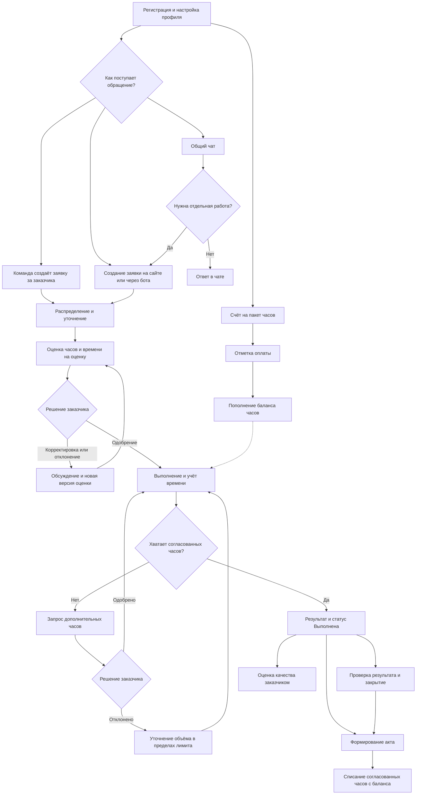

# Бизнес-процессы приложения «Кабинет заявок и биллинг»

Дата описания: 1 октября 2026 года. Версия документа: 1.0.

## 1. Назначение и границы

Приложение организует работу компании-исполнителя с заказчиками: принимает обращения, распределяет заявки, согласует трудозатраты, ведёт переписку и учёт выполненных работ, формирует счета и акты, учитывает баланс часов и собирает обратную связь.

Основной результат процесса — выполненная заявка с согласованным объёмом, историей общения, фактическими трудозатратами и финансовым документом. Обращение может закончиться консультацией в общем чате без создания заявки.

Документ описывает текущую реализацию. README и черновик PRODUCT_SPEC частично устарели: финансовый модуль уже присутствует в приложении. Предлагаемые правила и ограничения, требующие согласования, выделены отдельно в разделе 15. Наличие функции в коде не означает подтверждение её работы в промышленной среде.

## 2. Участники

| Участник | Ответственность |
|---|---|
| Заказчик | Регистрируется, описывает задачу, общается, принимает решение по оценке и дополнительным часам, просматривает документы и оценивает результат |
| Владелец организации заказчика | Видит общие заявки организации и может согласовывать их трудозатраты |
| Участник организации | Создаёт и обсуждает общие заявки; автор заявки также может согласовать её часы в текущей реализации |
| Наблюдатель организации | Читает общие заявки; не пишет в них и не согласовывает часы |
| Ответственный сотрудник | Уточняет задачу, оценивает её, выполняет работу, фиксирует время, запрашивает дополнительные часы |
| Менеджер | Распределяет обращения, управляет организациями и сроками, контролирует очередь, тарифы и финансовые документы |
| Администратор | Создаёт сотрудников и определяет их роли; выполняет функции управления и распределения |
| Система | Проверяет доступ и ограничения, сохраняет историю, рассчитывает показатели, формирует уведомления и финансовые записи |

Компания-исполнитель и организации заказчиков — разные сущности. Заказчик может работать самостоятельно или в составе организации. Основной ответственный по заявке один.

## 3. Общая схема

Покупка часов и выполнение заявок идут параллельно. Текущая реализация не блокирует работу при недостаточном балансе; создание акта может привести к отрицательному остатку.

## 4. Подключение и подготовка

1. Администратор создаётся при первичной настройке системы.
2. Администратор создаёт сотрудников и выбирает роль сотрудника или менеджера.
3. Заказчик регистрируется на сайте и входит в кабинет.
4. Заказчик заполняет профиль: имя, компанию и телефон. Телефон не выводится команде в карточке заявки согласно описанию профиля.
5. Менеджер или администратор при необходимости создаёт организацию заказчика, назначает владельца и добавляет уже зарегистрированных участников по email.
6. Для финансового учёта менеджер или администратор задаёт тариф и реквизиты клиента: ИНН, КПП для организации и юридический адрес.
7. Сотрудник заполняет рабочий профиль: ФИО, должность, описание и аватар.
8. Пользователь при желании подключает Telegram или MAX с подтверждением в веб-кабинете.

Результат: участники имеют учётные записи, права доступа и необходимые сведения для общения и документов.

## 5. Приём обращения

### 5.1. Прямая заявка

Заказчик выбирает вид услуги: доработка, интеграция, поддержка, консультация или другое. Указывает тему и описание ожидаемого результата, при необходимости прикладывает файлы и выбирает личную либо общую для организации видимость.

Система создаёт заявку с номером, автором, временем создания и статусом «Новая». Новая заявка поступает в очередь распределения, если ответственный ещё не назначен. В карточке сохраняется история дальнейших действий.

### 5.2. Общий чат

У заказчика есть отдельный постоянный чат с компанией-исполнителем. Можно задать вопрос без оформления заявки. Менеджер или администратор назначает сотрудника на чат; сотрудник работает только с назначенными ему чатами.

Если сообщение требует отдельной работы, сотрудник создаёт заявку из конкретного сообщения. Система связывает чат и заявку, переносит связанные вложения и предотвращает повторное создание заявки из того же сообщения. Переписка общего чата остаётся отдельной от переписки заявки.

### 5.3. Заявка за заказчика

Менеджер и администратор могут оформить заявку для любого зарегистрированного заказчика. Сотрудник — для заказчика, с которым уже работает по назначенной заявке или чату. Сотрудник становится ответственным за созданную им заявку; менеджер и администратор могут выбрать ответственного. Заказчик получает уведомление, а сведения о фактическом создателе сохраняются.

### 5.4. Файлы

В веб-кабинете к заявкам и сообщениям общего чата прикладываются изображения, PDF, документы, таблицы, TXT, CSV и ZIP до 10 МБ на файл. Доступ к файлам связан с доступом к соответствующему обращению. Вложения и голосовые сообщения в первой версии ботов не обрабатываются.

## 6. Распределение и уточнение

| Шаг | Исполнитель | Результат |
|---|---|---|
| Просмотр очереди | Менеджер или администратор | Найдены новые обращения и сообщения, требующие ответа |
| Назначение ответственного | Менеджер или администратор | Активный сотрудник получает обращение и уведомление |
| Первый ответ | Ответственный | Заказчик получает ответ или уточняющие вопросы |
| Уточнение задачи | Заказчик и ответственный | Понятны исходные данные и ожидаемый результат |
| Установка срока выполнения | Менеджер или администратор | В заявке записан срок |
| Переназначение при необходимости | Менеджер или администратор | История сохраняется, обычный прежний сотрудник теряет доступ |

Ориентиры для новых заявок: первый ответ за 24 календарных часа, оценка за 3 календарных дня. Выходные и праздники не исключаются. Очередь показывает следующее действие, просрочки и загрузку сотрудников.

## 7. Оценка и согласование

Ответственный указывает два отдельных показателя: плановые трудозатраты на выполнение и минуты, потраченные на подготовку оценки. Может добавить пояснение. Система сохраняет номер версии оценки и отправляет уведомление заказчику.

| Решение | Действие системы | Следующий шаг |
|---|---|---|
| Одобрить | Актуальная оценка получает состояние «Одобрена» | Ответственный может начать работу |
| Отклонить | Оценка получает состояние «Отклонена» | Обсуждение дальнейшей работы или новая оценка |
| Запросить корректировку | Сохраняются комментарий и/или желаемое количество часов | Ответственный готовит новую версию |

Правила:

- Решение принимает автор заявки, имеющий право писать в неё, либо владелец организации для общей заявки.
- Наблюдатель не согласовывает часы.
- Рассматривается только актуальная ожидающая решения версия. Повторное решение и решение по старой версии не принимаются.
- Пока оценка ожидает решения или уже одобрена, обычная новая оценка не создаётся. После одобрения увеличение объёма идёт через дополнительные часы.
- История версий, комментариев и времени оценки сохраняется.
- Старую денежную оценку необходимо заменить оценкой в часах.
- Само одобрение оценки не списывает баланс. Время подготовки оценки учитывается отдельно и автоматически не тарифицируется.

## 8. Выполнение и дополнительные часы

1. После согласования ответственный переводит заявку в работу.
2. Выполняет задачу и вносит записи времени: количество минут и описание сделанного.
3. Система суммирует фактическое время и сравнивает его с согласованным лимитом.
4. Если лимита недостаточно, ответственный указывает дополнительные минуты и причину запроса.
5. Заказчик одобряет или отклоняет запрос. Одобрение увеличивает общий лимит; отклонение оставляет его прежним.
6. Ответственный продолжает работу в пределах доступного согласованного объёма либо обсуждает изменение задачи.

Согласованный лимит = актуальная одобренная оценка + одобренные дополнительные часы.

Фактическое время = сумма записей выполненной работы.

Превысить лимит записью времени нельзя. Одновременно допускается один ожидающий решения запрос дополнительных часов. Запрос возможен в статусах «В работе» и «Ожидает заказчика». Пока запрос не рассмотрен, завершение или закрытие заявки блокируется.

## 9. Результат, закрытие и обратная связь

Ответственный сообщает результат в переписке и переводит заявку в «Выполнена». Для завершения и закрытия нужны одобренная оценка, хотя бы одна запись фактического времени и отсутствие ожидающего запроса дополнительных часов.

Заказчик проверяет результат и сообщает замечания. Закрытие выполняет ответственный или администратор. Отдельного обязательного действия заказчика «Принять результат» в текущем серверном процессе нет; проверка результата является организационным этапом общения.

Автор заявки может оставить оценку от 1 до 5 и комментарий после выполнения или закрытия. Система сохраняет отзыв и уведомляет ответственного. Оценка качества не создаёт финансовой операции.

| Статус | Деловое значение |
|---|---|
| Новая | Обращение зарегистрировано; требуется назначение, уточнение или оценка |
| В работе | Согласованная задача выполняется |
| Ожидает заказчика | Для продолжения нужен ответ или действие заказчика |
| Выполнена | Результат подготовлен, можно проверить его и оформить акт |
| Закрыта | Обработка завершена; новые сообщения и оценки заявки ограничены |

Типовая последовательность статусов описывает рабочий порядок, но код не задаёт строгую матрицу всех переходов. Отдельного статуса отмены заявки нет. Отклонение оценки не является автоматическим закрытием заявки.

## 10. Биллинг: тариф, баланс, счета и акты

### 10.1. Модель учёта

Баланс хранится в минутах оплаченного обслуживания для организации или самостоятельного заказчика. Денежный эквивалент рассчитывается по текущему тарифу. В коде применяется ставка по умолчанию 3 000 руб./час, если индивидуальная ставка не задана.

В финансовом обзоре отдельно показаны остаток, согласованные часы активных заявок, завершённые часы без акта, документы и история операций. Показатель часов в работе информационный: согласование не резервирует и не списывает минуты с баланса.

### 10.2. Счёт на пакет часов

1. Менеджер или администратор выбирает клиента, количество часов, описание и примечание.
2. Система рассчитывает сумму по тарифу и создаёт счёт со статусом «Выставлен» и номером вида «СЧ-год-номер».
3. Заказчик просматривает документ и печатную форму.
4. В текущей реализации заказчик может отметить свой выставленный документ оплаченным; менеджер или администратор также меняет статус.
5. При переходе счёта в «Оплачен» система прибавляет минуты пакета к балансу и создаёт операцию пополнения.

Создание счёта само по себе не пополняет баланс. Отметка «Оплачен» является действием пользователя, а не подтверждённым поступлением денег от банка или платёжного провайдера.

### 10.3. Ручное пополнение

Менеджер или администратор вводит минуты либо сумму и описание основания. Если введены только минуты, система рассчитывает сумму; если только сумма — переводит её в минуты по тарифу. Баланс увеличивается, операция сохраняется с автором и датой. Рекомендуется использовать этот сценарий только после сверки основания пополнения.

### 10.4. Акт выполненных работ

1. Менеджер или администратор выбирает клиента и завершённые заявки без акта.
2. Система формирует строки с номером заявки, названием, согласованными часами, тарифом и суммой.
3. Создаёт акт со статусом «Выставлен» и номером вида «АКТ-год-номер».
4. Связывает заявки с актом.
5. Сразу при создании акта вычитает согласованные минуты из баланса и записывает списание.
6. Заказчик просматривает акт и его печатную форму.

Списание рассчитывается по согласованным часам, включая одобренное увеличение, а не по фактическому времени. Подписание акта или отметка его оплаты не является условием первоначального списания.

### 10.5. Отмена документов

Менеджер или администратор может отменить документ. Отмена акта возвращает минуты на баланс, создаёт корректировку и снимает связь заявок с актом, позволяя оформить их заново. Отмена счёта не содержит автоматического возврата уже зачисленных минут; порядок возвратов следует согласовать отдельно.

### 10.6. Пример полного расчёта

При тарифе 3 000 руб./час счёт на 10 часов составляет 30 000 руб. После отметки оплаты баланс равен 600 минутам. По заявке согласованы 2 часа и ещё 1 дополнительный час; фактически записано 2,5 часа. Акт содержит 3 согласованных часа на 9 000 руб. После создания акта остаток равен 7 часам. При отмене этого акта 3 часа возвращаются на баланс.

## 11. Коммуникации и уведомления

Переписка делится на общий чат клиента, обсуждение конкретной заявки и внутренние заметки команды. Внутренние заметки доступны сотрудникам через отдельный механизм и не предназначены для заказчика. Шаблоны ответов помогают повторно использовать типовые тексты.

Уведомления создаются о новых обращениях, назначениях, сообщениях, оценках, решениях, дополнительных часах, изменении статусов и отзывах. Счётчик непрочитанных событий помогает определить следующее действие. Уведомление не заменяет сохранённую запись в карточке заявки.

### Telegram и MAX

1. Пользователь создаёт команду привязки в веб-кабинете.
2. Отправляет её боту в личном диалоге.
3. Получает код и подтверждает его на сайте. До подтверждения доступ к кабинету не предоставляется.
4. Выбирает основной канал, оба канала или отключает внешние уведомления.
5. Через бот заказчик создаёт заявку по шагам «тема → описание → проверка → отправка», общается и принимает решение по актуальной оценке.
6. Сотрудник получает уведомления со ссылками и выполняет работу в веб-кабинете.

Данные заявок и решений общие для сайта и обоих ботов. Если адресат сообщения неясен, бот предлагает выбрать диалог. Черновики заявок отдельные для каждого бота и хранятся 24 часа. Отключение привязки прекращает будущую доставку и удаляет связанные черновики; уже доставленные сообщения остаются в мессенджере.

Реальная доставка требует настроенных токенов, HTTPS и работающего процесса доставки. Временные ошибки повторяются через очередь; окончательно неуспешные отправки требуют разбора. Повтор внешнего события не должен повторять создание заявки или решение по оценке. В отдельных сетевых ситуациях возможно дублирование самого уведомления. Email-доставка не реализована.

## 12. База знаний, интеграции и управленческий контроль

**База знаний.** Сотрудники создают и редактируют статьи по категориям, выбирая публичную или внутреннюю видимость. Пользователь ищет готовый ответ; приложение предлагает подходящие публичные статьи. Читатель оценивает полезность. Публичные материалы доступны и без входа; внутренние — сотрудникам.

**Связи с разработкой.** Команда добавляет к заявке ссылки на ветку, коммит или pull request. Они связывают задачу с изменениями в репозитории; сами по себе не означают автоматическое выполнение или приёмку работы.

**Внешние интеграции.** Через настроенные webhook система сообщает внешним сервисам о выбранных событиях заявок, согласования и финансовых документов. Доступны настройка, тестирование и журнал доставки. Это механизм обмена событиями; конкретная внешняя бизнес-система подключается отдельно.

**Аналитика.** Руководитель отслеживает количество открытых и завершённых заявок, время ответа и выполнения, соблюдение ориентиров, загрузку и учёт времени сотрудников, оценки качества и распределение услуг. Доступен экспорт CSV. Показатели рассчитываются из текущих данных и не заменяют бухгалтерскую сверку.

## 13. Данные и контрольные правила

| Данные | Для чего сохраняются |
|---|---|
| Пользователь, профиль, организация и членство | Идентификация, контакты и область доступа |
| Заявка, назначение, статус и срок | Управление исполнением и историей |
| Оценка и решение | Подтверждение согласованного объёма |
| Запрос дополнительных часов | Обоснование увеличения объёма |
| Записи времени | Подтверждение фактически выполненной работы |
| Сообщения, заметки и вложения | Контекст и рабочие материалы |
| Счёт, акт и финансовая операция | Основание пополнения, списания и корректировки |
| Тариф и баланс минут | Расчёт стоимости и доступного объёма обслуживания |
| Отзыв и статья базы знаний | Контроль качества и накопление опыта |
| Привязка мессенджера и очередь уведомлений | Внешняя коммуникация и восстановление доставки |

Контрольные точки основного процесса:

- До начала выполнения есть актуальное одобрение часов.
- Оценку, рабочее время и дополнительные часы оформляет ответственный сотрудник.
- Фактическое время не превышает согласованный лимит.
- До завершения внесено время и рассмотрены дополнительные часы.
- Перед актом выполненные заявки сверены с клиентом и основанием начисления.
- Пополнение и списание имеют описание или связанный документ.
- Доступ к личным и общим заявкам проверяется сервером.
- История общения и назначений сохраняется при смене ответственного.
- Для рабочего запуска требуется резервное копирование базы и вложений с проверкой восстановления.

## 14. Исключения и следующий шаг

| Ситуация | Действие |
|---|---|
| Не хватает данных для оценки | Ответственный запрашивает уточнение в переписке |
| Ответственный не назначен | Менеджер или администратор распределяет обращение |
| Оценка отклонена | Стороны обсуждают объём; ответственный может отправить новую версию |
| Нужны дополнительные часы | Ответственный отправляет обоснованный запрос до превышения лимита |
| Дополнительные часы отклонены | Работа остаётся в ранее согласованном лимите; объём уточняется |
| Есть замечания к результату | Заказчик пишет в заявке, команда определяет доработку и необходимость нового согласования |
| Недостаточно баланса | Требуется пополнение или отдельное решение менеджера; автоматической блокировки нет |
| Ошибка уведомления | Данные проверяются в кабинете; команда разбирает доставку |
| Ошибочный акт | Менеджер или администратор отменяет акт, сверяет корректировку и формирует правильный документ |
| Повторная отправка сообщения или решения | Для поддерживаемых операций система проверяет повтор и актуальность состояния |

## 15. Правила, которые нужно утвердить перед рабочим использованием

Этот раздел не изменяет приложение; он фиксирует отличия желаемого регламента от текущей реализации.

1. **Подтверждение оплаты.** Сейчас отметка заказчика может зачислить часы. Нужно определить, кто проверяет поступление денег и когда допускается пополнение; банковской автоматической проверки нет.
2. **База начисления.** Сейчас акт списывает согласованные часы. Нужно подтвердить оплату согласованного объёма либо перейти на фактические трудозатраты и определить порядок согласования расхождений.
3. **Отрицательный баланс.** Определить допустимость долга, кредитный лимит и момент блокировки новых работ.
4. **Тарифы.** Утвердить валюту, изменение ставки и сохранение стоимости ранее оплаченного пакета. Денежный эквивалент текущего остатка меняется вместе с текущим тарифом.
5. **Повторные финансовые операции.** В текущем обработчике переход документа из другого статуса в «Оплачен» может снова зачислить часы. Нужны строгие переходы статусов, однократное зачисление и отдельная проверка конкурентных действий.
6. **Отмена и возврат.** Утвердить отмену оплаченного счёта, денежный возврат, отмену акта и сверку баланса. Возврат минут и возврат денег — разные операции.
7. **Подбор заявок в акт.** При явной передаче номеров заявок код не повторяет все проверки принадлежности клиенту и завершённости. Перед рабочим использованием эти проверки необходимо обеспечить на сервере.
8. **Права на финансовые данные.** Текущие финансовые списки доступны команде шире, чем назначенные заявки; внутри организации документы доступны участникам без отдельного финансового разграничения. Нужен согласованный набор прав.
9. **Согласование организационных заявок.** Сейчас автор с правом записи также принимает решение по часам. Если согласовывать должен исключительно владелец, правило нужно изменить.
10. **Закрытие и отмена заявки.** Утвердить обязательность приёмки заказчиком, причины отмены, повторное открытие и допустимые переходы статусов.
11. **Сроки.** Подтвердить обязательные SLA, рабочий календарь, приоритеты и последствия просрочки. Текущие значения — календарные ориентиры.
12. **Готовность каналов.** Провести проверку Telegram и MAX с реальными настройками. Нативное мобильное приложение и платёжный провайдер остаются отдельными этапами развития.

## 16. Основания описания

Описание сверено с имеющимся графом проекта и текущими обработчиками приложения. Для актуального финансового поведения приоритет имеет реализация, поскольку ранние документы относят биллинг к будущим этапам.

- `app.py`: создание и доступ к заявкам; оценки и решения; статусы; учёт времени; дополнительные часы; организации; аналитика; база знаний; интеграции; финансовый обзор, пополнения, счета и акты.
- `web/main.js`: наименования статусов, услуг и разделов интерфейса.
- `README.md`: назначение продукта, сценарии обращений, вложения и ориентиры сроков.
- `BOTS.md`: подключение мессенджеров, сценарии общения и ограничения доставки.
- `ARCHITECTURE.md`: единая бизнес-логика веба и ботов.
- `PRODUCT_SPEC.md`: первоначальные требования и направления развития; предложения из черновика не считаются автоматически реализованными.

Документ описывает процесс и не является протоколом испытаний приложения или утверждённым финансовым регламентом.
